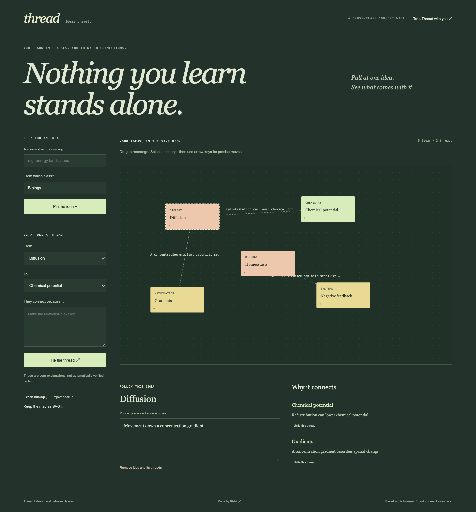

# Thread

A concept wall for connecting ideas across classes—with a reason for every link.

[Local app download](https://github.com/rishitpradhan-gif/thread/releases/latest) · [Extension download](https://github.com/rishitpradhan-gif/thread/releases/latest) · [Install guide](extension/INSTALL.md)

## What it does

Add concepts and course labels, drag them or move them with the arrow keys, and connect two ideas by writing why they belong together. Select an idea to edit its explanation and inspect its links. Remove concepts/links, export an SVG, or keep a complete JSON backup. Maps support up to 80 concepts and 160 directed connections. Explanations belong to the student; they are not automatically fact-checked.

## Download the app

Download `thread-local.zip` from Releases and extract all files. Python 3.10+ is enough; no Node.js or npm install is needed for the prebuilt download.

```sh
python3 serve.py
```

Windows: `py -3 serve.py`. Open **http://127.0.0.1:8000**. Keep the terminal open; Ctrl+C stops it. Use `--port 8001` if port 8000 is busy. Open the local URL rather than double-clicking app/index.html.

## Install the extension

1. Download `thread-extension.zip` and extract it.
2. Open `chrome://extensions` or `edge://extensions` on desktop.
3. Turn on **Developer mode** and choose **Load unpacked**.
4. Select the extracted inner folder containing `manifest.json`.
5. Pin the extension. Select text on a normal web page, click the extension, and save the selection. Or use the selection’s right-click menu.
6. Open the bundled workspace, then use **From your reading** to import a clip.

This is an unpacked Manifest V3 extension, not an extension-store listing. Managed school devices may prohibit developer extensions. Browser settings pages, protected store pages, and some PDF viewers cannot be captured. See [the full guide](extension/INSTALL.md).

## Local data and privacy

Workspaces are saved in this browser’s local storage. Extension clips use extension local storage. The hosted website, local app, and extension are separate storage locations; use JSON export/import to move work. Export a backup before uninstalling, changing browser profiles, or clearing site data. Data is not encrypted by this app or synchronized to a server.

The extension requests only `activeTab`, `scripting`, `storage`, and `contextMenus`. It reads the selection, title, and URL after an explicit action. No wildcard host permission, browsing-history permission, remote script, analytics, automatic page collection, or external inference API. The inbox holds up to 100 clips of 20,000 characters each. A tool may require a shorter excerpt to fit its page/concept limits and will report that limit.

The portable interface uses local system fonts and has no remote asset dependency. Hosted installation through the browser’s app menu is available only where the browser supports it; these downloads are browser apps, not signed native operating-system installers.

## Develop and verify

Node.js 22.17+ and npm:

```sh
npm ci
npm run dev
node --test engine/test.mjs
npm run build
```

Build both local ZIPs from this repository:

```sh
python3 scripts/package-app.py
```

The same React view and pure engine are used for the website, portable app, and extension workspace. The website uses the supported Sites/Vinext starter; portable builds use Vite. Installation and browser-test evidence is recorded under `docs/` when completed; no active hosted CI is claimed.

## Design and provenance

Each tool has a distinct, hand-composed visual direction using local typography: annotated paper, a green concept wall, or a folded revision book. A Figma file was created for these three, but the Starter MCP quota blocked editing and rendering. **No completed Figma design for these tools is claimed.**

Rishit Pradhan directed the work. Implementation and design drafting were AI-assisted. These are original small implementations of established note-structuring, concept-mapping, and mini-zine techniques, not claims of worldwide novelty or educational-outcome validation.

MIT licensed; dependency licenses remain their own.

## Verified release evidence

Real Chrome app workflows, desktop/mobile layouts, exported files, reload persistence, and extracted local packages passed their checks. Each extension was installed as an actual unpacked extension in an isolated Chrome profile; the real toolbar permission grant, selected-text capture handler, local inbox import, and deletion were checked. The native toolbar popup is a Chrome `other` target; capture messages were invoked through the bundled extension context after that grant. See `docs/extension-verification.json` for the exact scope. Edge installation is documented but was not independently browser-tested.



[Mobile interface](docs/screenshots/mobile.png) · [Extension workspace](docs/screenshots/extension-workspace.png)
